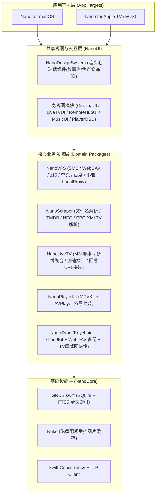

# Nano 全能流媒体中心 — 产品需求与技术架构说明书 (PRD & 模块清单)

> [!NOTE]
> **应用名称**：Nano (`app.nano.media`)  
> **目标平台**：macOS 14.0+ (Sonoma 及以上) 、tvOS 17.0+ (Apple TV HD / 4K)  
> **技术底座**：100% Swift & SwiftUI 原生架构 + 双内核播放引擎（`MPVKit` + `AVPlayer`）  
> **核心定稿策略**：  
> 1. **网盘双轨鉴权**：优先走方案 A（官方 OpenAPI），不支持或受限时自动降级/切换至方案 B（Web/TV 扫码获取 Cookie/Token + 本地流式代理网关直链）；  
> 2. **远程资源全兼容**：同时支持标准苹果 CMS JSON/XML 接口、TVBox/FongMi `json` 订阅规则、以及声明式自定义网页爬虫规则；  
> 3. **产品定位**：将分散在 **主流网盘（115/夸克/百度）、本地 NAS、小雅 AList、远程影视源、IPTV 电视直播、无损音乐库** 的数字媒体资产，统一收敛至高颜值暗夜毛玻璃界面的超级流媒体终端。

---

## 一、 视觉设计语言与双端交互架构 (UI/UX Specification)

### 1.1 视觉风格基准（参考标杆复刻与提炼）
* **深空暗夜底色**：主背景采用深蓝黑径向渐变（`#0B0F17` -> `#131B2E`），卡片容器采用 SwiftUI `.ultraThinMaterial` 半透明毛玻璃叠加 `rgba(255,255,255,0.08)` 的 `1px` 微光描边。
* **色彩语义系统**：
  * **主强调色（胶囊选中/主按钮）**：电光蓝 `#2F7CF6` 与琥珀金 `#F5B041`（用于焦点徽章、继续播放按钮、评分星标）。
  * **状态指示色**：在线/启用 `#2ECC71`（呼吸绿点）、直播中 `#E74C3C`（呼吸红点）、需验证/高延迟 `#F39C12`（琥珀黄）。
* **动态氛围光效（Ambient Background）**：进入影视详情页或音乐全屏页时，自动提取封面主色调生成顶部高斯模糊弥散背景，向下平滑过渡至纯暗色。
* **顶部悬浮胶囊栏（Floating Pill Bar）**：二级子模块统一采用顶部居右或居中的半透明胶囊切换器（如 IPTV 页的 `直播 | 节目单 | 回看 | 信号 | 源库`），带实时数量角标。

### 1.2 页面路由与双端交互映射（macOS vs Apple TV）

双端共享同一套 ViewModel 与数据状态，仅在顶层导航容器与焦点交互层做平台差异化编译（`#if os(macOS)` / `#if os(tvOS)`）：

| 交互维度 | macOS 桌面端 | Apple TV (tvOS 10英尺体验) |
| :--- | :--- | :--- |
| **一级导航容器** | `NavigationSplitView` 左侧常驻可折叠树状边栏（支持分组折叠、计数徽章、右键菜单） | 顶部或左侧自动收起式 `TabView (.sidebarAdaptable)`，遥控器 Menu 键随时呼出导航抽屉 |
| **二级视图切换** | 窗口顶部 Toolbar 悬浮胶囊切换器 + 全局搜索框 | 频道/分类横向胶囊瀑布流，焦点移入自动放大 `1.05x` 并附带阴影高光（`.hoverEffect(.highlight)`） |
| **卡片微交互** | 鼠标悬停（Hover）浮现播放按钮、收藏星标或弹出单集剧情浮层 | 遥控器触控板轻扫移动焦点，长按「确认键」呼出上下文菜单（标记已看/切换线路/重刮削） |
| **播放控制层** | 顶部标题/线路栏 + 底部进度/选台抽屉，支持独立小窗、画中画（PiP）、快捷键倍速 | 遥控器「下键」呼出底部横向快速选台卡片抽屉，「上键」呼出音轨/字幕/片头跳过面板 |

### 1.3 全局一级侧边栏目录树结构
1. **个人与全局**：全局聚合搜索、最近观看（跨源续播）、个人收藏、片单
2. **网络存储（挂载源）**：已接入的 SMB / WebDAV / 115 网盘 / 夸克网盘 / 百度网盘 / Emby / 小雅 OpenList（支持展开进入「影院海报墙」或「文件目录」）
3. **网络电视（IPTV）**：全频直播、收藏频道、最近观看、各订阅源树状分组（央视 / 卫视 / 港澳台 / 4K频道 / 地方台）、`+ 导入电视源`
4. **网络资源（远程聚合源）**：全部资源仪表盘、各扩展站点快捷入口（FongMi 源 / CMS JSON 源 / 网页解析源）
5. **音乐中心**：全部歌曲、专辑、艺术家、歌单、文件夹直听
6. **隐私空间（默认隐藏）**：解锁后动态浮现加密挂载源与私密网络资源
7. **系统设置**：同步管理（iCloud / WebDAV）、播放与解码、刮削配置、缓存管家

---

## 二、 全量功能模块清单 (PRD Module Matrix)

### 模块 M1：统一虚拟文件系统与云盘直连层 (`NanoVFS`)
将不同网盘和本地协议统一抽象为标准虚拟文件接口（列目录、查详情、取直链、刷新鉴权）：

| 子模块 | 功能点 | 详细需求说明 | 优先级 |
| :--- | :--- | :--- | :---: |
| **本地与私有云** | SMB 2/3、NFS、WebDAV | 支持局域网 Bonjour/mDNS 自动发现 NAS（群晖/威联通/飞牛OS），展示协议类型与挂载路径 | P0 |
| **主流网盘原生直连** | **115 网盘 / 夸克网盘 / 百度网盘**（预留阿里云盘） | 统一采用 **手机扫码登录** 获取授权凭证；后台自动保活刷新 Cookie/Token；卡片展示网盘容量占用与连接状态 | P0 |
| **本地流式代理网关** | Local HTTP Stream Proxy | 内置轻量本地回环代理（`127.0.0.1:port`），自动为百度/夸克/115 直链注入专属 `User-Agent`、`Cookie`、`Referer` 并支持多线程分片预取（Range 请求加速拖动） | P0 |
| **媒体服直连** | Emby / Jellyfin 原生协议 | 直接挂载服务端媒体库分类、复用已有海报元数据与播放记录，免本地重复刮削 | P1 |
| **小雅专属适配** | AList / OpenList V3 API | 原生对接 API（非慢速 WebDAV），支持 **302 重定向直链穿透** 至用户自己的夸克/115/阿里云盘秒播，支持小雅目录懒加载与免扫库全局接口搜索 | P0 |

---

### 模块 M2：NAS / 网盘智能影院与海报墙 (`NanoCinema`)
对标参考图中的「影院详情页」与高颜值海报墙体验：

| 子模块 | 功能点 | 详细需求说明 | 优先级 |
| :--- | :--- | :--- | :---: |
| **智能刮削引擎** | 文件名清洗 + TMDB / 豆瓣刮削 | 正则精准识别片名、年份、`S01E02` 季集、分辨率（`4K`/`1080P`）、动态范围（`DV`/`HDR`）；优先读取目录内本地 `.nfo` 与 `poster.jpg` | P0 |
| **影院详情页** | 沉浸式剧集档案页 | 展示高清海报、评分、首播日期、季数/集数、HDR/帧率规格、TMDB 编号、圆形演职员表、预告片播放、手动重新匹配刮削按钮 | P0 |
| **剧集列表与进度** | 横向剧照卡片流 | 单集展示剧照缩略图、集号、标题、分集剧情简介、观看进度百分比徽章（如 `上次看到 15%`）与剩余时长 | P0 |
| **片头片尾跳过** | 剧集级跳过配置 | 详情页支持一键设定片头时长（如 `114s`）与片尾时长，支持读取 MKV Chapter 章节标记，同季剧集自动继承生效 | P0 |
| **双视图切换** | 海报墙模式 / 纯文件树模式 | 未刮削目录或网盘杂乱目录支持按「纯文件夹视图」直接浏览即点即播，支持视频缩略图实时截取 | P0 |
| **多版本聚合** | 同片源合并 | 同一部电影在不同网盘或不同清晰度下自动合并，详情页通过胶囊切换播放源 | P1 |

---

### 模块 M3：网络资源聚合中心 (`NanoRemoteHub`)
完整对标参考图中的「网络资源统计仪表盘 + 资源管理列表」：

| 子模块 | 功能点 | 详细需求说明 | 优先级 |
| :--- | :--- | :--- | :---: |
| **多源规则兼容** | 标准 CMS JSON/XML、FongMi/TVBox 源、网页嗅探规则 | 支持一键导入单源或订阅合集包，每个源独立沙盒运行与启停开关 | P1 |
| **资源统计仪表盘** | 联网状态环形表 + 6 维数据卡 | 顶部实时汇总：在线源比例（如 `5/14 已连接`）、总频道/分类数、今日更新记录数、续看数、稍后看、关注演员/题材、自建片单数 | P1 |
| **并发健康度检测** | 一键测速与状态巡检 | 并发检测所有远程源连通性，展示 `● 在线 / ● 需验证 / ● 离线`、响应耗时（`ms`）、分类数与缓存图片数 | P1 |
| **多维内容发现** | `资源 / 榜单 / 日历 / 足迹 / 片单 / 关注` | 支持跨源并发搜索（片名/演员/标签），支持追番/追剧更新日历与历史浏览足迹 | P2 |
| **磁盘缓存管家** | 海报与视频缓存配额上限 | 可分别设置海报缓存上限（如 `2GB`）与视频缓冲上限（如 `10GB`），可视化分段进度条展示占用并支持一键清理（**保护 Apple TV 有限存储空间**） | P0 |

---

### 模块 M4：IPTV 网络电视中心 (`NanoLiveTV`)
完整对标参考图中的「直播网格 + 回看时间轴 + 播放器底部选台抽屉」：

| 子模块 | 功能点 | 详细需求说明 | 优先级 |
| :--- | :--- | :--- | :---: |
| **直播源管理** | M3U / M3U8 / TXT / Xtream 订阅 | 支持定时自动更新订阅源、自定义请求 UA/Referer、IPv4/IPv6 路由筛选、组播转单播（udpxy）地址改写 | P0 |
| **双维度智能分类** | `按类型` / `按省份` + 胶囊筛选 | 自动归类 `收藏 / 最近 / 全部 / 央视 / 卫视 / 港澳台 / 地方 / 4K8K`；卡片展示台标、频道号、频道名、当前正在播出节目名及时间段进度 | P0 |
| **同名频道多线聚合** | 毫秒级故障自动切源 | 多源导入的同名频道（如 `CCTV-5`）自动聚合为 `1/25` 条线路，优先播放低延迟高码率源，断流自动无缝切下一线路 | P0 |
| **EPG 与回看中心** | XMLTV 电子节目单 + 多日回看 | 对接 XMLTV 压缩包（`.xml` / `.xml.gz`），自动识别支持 `catchup`（`append`/`default`/`shift`）的频道，提供「今天 / 昨天 / 前 N 天」分栏节目单一键回放 | P1 |
| **信号批量巡检** | 后台静默测速与探针 | 检测直播流有效性与真实分辨率/帧率，支持一键隐藏失效频道 | P1 |

---

### 模块 M5：高解析度音乐中心 (`NanoMusic`)

| 子模块 | 功能点 | 详细需求说明 | 优先级 |
| :--- | :--- | :--- | :---: |
| **全渠道音源接入** | 网盘 / NAS 音乐目录 + Subsonic/Navidrome | 无需下载整张专辑，直接流式解码云盘或本地 NAS 中的音乐库 | P1 |
| **Hi-Fi 音频解码** | 无损格式与分轨支持 | 支持 `FLAC`、`ALAC`、`APE`、`WAV`、`DSD (DSF/DFF)`、`AAC`、`MP3`，原生解析整轨 `.cue` 自动虚拟分轨与无缝连播（Gapless） | P1 |
| **双端专属音乐 UI** | macOS 迷你栏 + tvOS 流体歌词屏保 | macOS 提供窗口底部常驻控制条与菜单栏歌词；Apple TV 提供类 Apple Music 的动态流体背景 + 逐字/逐行大字滚动歌词全屏模式 | P1 |

---

### 模块 M6：双内核播放引擎 (`NanoPlayerKit`)

* **画质与音效**：开启 `VideoToolbox` 硬件加速解码，支持 HDR10 / HLG / Dolby Vision 色调映射，tvOS 支持自动匹配原片动态范围与帧率。
* **字幕全链路**：内置内封字幕轨道切换、外挂同目录字幕自动加载（`.ass`/`.srt`/`.sup`），集成在线字幕实时搜索下载（射手网 / OpenSubtitles），支持时间轴偏移 `±0.1s` 微调与字体样式定制。
* **直播与点播差异化 OSD**：
  * **直播态 OSD**：顶部悬浮当前台标、当前节目与下一档节目预告、线路切换器（`< 央视三套 7/25 >`）；底部悬浮同分组频道横向快切抽屉。
  * **点播态 OSD**：支持缩略图进度条拖拽预览、选集抽屉、倍速控制（`0.5x ~ 4.0x` 及长按方向键瞬时 `2.0x` 倍速）、音频/字幕轨道面板。

---

### 模块 M7：多端同步、TV 免输快传与隐私保护 (`NanoSync & Security`)

| 子模块 | 功能点 | 详细需求说明 | 优先级 |
| :--- | :--- | :--- | :---: |
| **分层无感同步** | iCloud Keychain + CloudKit + WebDAV | **敏感凭证**（网盘 Token/Cookie、SMB 密码）走 iCloud Keychain 加密同步（Mac 扫码一次，Apple TV 自动免登）；**观看进度/收藏**走 CloudKit 实时同步；**全量源配置与数据库快照**支持定时加密备份至自定义 WebDAV | P0 |
| **Apple TV 局域网助手** | 扫码网页快传与代理登录 | tvOS 端内置 `NWListener` 局域网微服务端，手机/电脑扫码打开局域网管理页，直接粘贴 M3U 链接、小雅地址、导入配置文件或完成网盘扫码授权 | P0 |
| **隐私保险箱** | 隐身分区锁 | 支持将指定存储目录或整个「网络资源」标记为私密；默认在 UI 与全局搜索中彻底隐身，macOS 通过 `Touch ID`/密码解锁，tvOS 通过遥控器 PIN 码解锁，切后台可自动上锁 | P1 |

---

## 三、 SwiftUI 模块化工程架构设计

建议采用 **Workspace + 本地 Swift Package 模块化拆分**，确保编译速度快、双端边界清晰、后续可扩展至 iOS/iPadOS：

---

## 四、 核心本地数据库模型 (SQLite / GRDB Schema)

采用单库多表设计，既满足毫秒级跨源检索（FTS5），又便于整体打包加密同步至 WebDAV：

1. **`storage_source`（网络存储与网盘源表）**
   * `id` (UUID PK), `name`, `type` (`smb`/`webdav`/`115`/`quark`/`baidu`/`alist`/`emby`), `endpoint_url`, `root_path`, `credential_keychain_id` (关联 Keychain，库内不落明文密码), `is_private` (隐私标记), `quota_used`, `quota_total`, `created_at`
2. **`media_item` & `media_episode`（影院刮削主表与分集表）**
   * `media_item`: `id`, `tmdb_id`, `media_type` (`movie`/`tv`), `title`, `original_title`, `year`, `rating`, `overview`, `poster_url`, `backdrop_url`, `genres_json`, `cast_json`, `intro_skip_sec`, `outro_skip_sec`
   * `media_episode`: `id`, `media_id`, `source_id`, `season_num`, `episode_num`, `title`, `overview`, `still_url`, `vfs_path`, `video_specs_json` (4K/HDR/60fps)
3. **`playback_history`（跨源统一播放进度与最近观看表）**
   * `id`, `content_type` (`vod`/`episode`/`live`/`remote`/`music`), `target_id`, `source_id`, `position_sec`, `duration_sec`, `progress_pct`, `is_finished`, `updated_at`
4. **`iptv_subscription`、`iptv_channel` & `iptv_epg`（直播与节目单表）**
   * `iptv_subscription`: `id`, `name`, `m3u_url`, `epg_url`, `ua`, `last_sync_at`
   * `iptv_channel`: `id`, `sub_id`, `group_title`, `province`, `standard_name` (归一化频道名，用于多线合并), `logo_url`, `stream_url`, `catchup_type`, `catchup_source`, `latency_ms`, `is_favorite`
   * `iptv_epg`: `channel_std_name`, `start_time`, `end_time`, `program_title`（按天自动清理过期数据）
5. **`remote_site`（远程扩展资源站表）**
   * `id`, `name`, `site_type` (`cms_json`/`fongmi`/`webview`), `api_url`, `ext_config`, `is_enabled`, `is_private`, `status` (`online`/`verify`/`offline`), `latency_ms`, `cached_bytes`
6. **`music_track`（音乐元数据索引表）**
   * `id`, `source_id`, `vfs_path`, `cue_index`, `title`, `artist`, `album`, `cover_url`, `duration_sec`, `format`, `sample_rate`, `lyrics_lrc`

---

## 五、 分阶段研发路线图 (MVP -> V1.0 Roadmap)

建议分 **4 个迭代阶段** 稳步推进，每个阶段都有可实际日常使用的产出：

### 阶段一：V0.1 骨架与播放底座（打通双端 UI + 本地/SMB/小雅播放）
* 搭建 Xcode Workspace（macOS + tvOS 双 Target）及 `NanoDesignSystem` 暗夜毛玻璃组件库（左侧边栏、胶囊栏、卡片网格）。
* 集成 `MPVKit` + `AVPlayer` 双引擎封装，跑通点播 OSD 控制层与字幕加载。
* 实现 `SMB`、`WebDAV` 与 **小雅 OpenList API（含 302 直链）** 接入，支持纯目录浏览秒播与播放进度记忆。

### 阶段二：V0.2 主流网盘直连 + 影院海报墙刮削
* 攻克 **115 网盘、夸克网盘、百度网盘** 扫码授权登录与 Local HTTP Proxy 流式直链播放。
* 落地 `GRDB` 数据库与 TMDB 刮削引擎，完成《影院详情页》（海报氛围光、演职员表、分集剧照进度、跳过片头片尾）。
* 接入 **iCloud Keychain（凭证免登同步）** + **Apple TV 局域网扫码快传助手** + **磁盘缓存上限管家**。

### 阶段三：V0.3 IPTV 网络电视全功能复刻
* 完成 M3U/TXT 源解析、自动央卫视/省份归类、同名频道多线路聚合与断流自动切源。
* 完成 XMLTV 节目单解析、**多日回看时间轴页面**、播放器底部横向快速选台抽屉与批量信号测速。

### 阶段四：V1.0 网络资源中心 + 无损音乐 + WebDAV 同步与隐私空间
* 实现远程资源站（CMS / FongMi 源）接入与「资源统计健康度仪表盘」、跨源并发搜索。
* 上线独立「音乐中心」（无损/CUE 分轨解码 + macOS 迷你播放栏 + tvOS 全屏流体歌词）。
* 完成 WebDAV 全量配置快照加密同步与「隐私空间锁（Touch ID / PIN）」。
